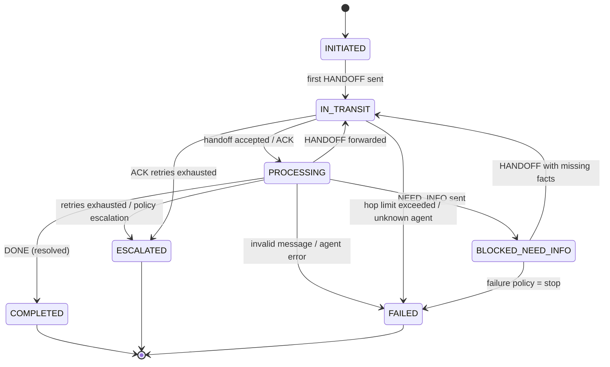

# Agent Handoff Protocol (AHP) — Specification

| | |
|---|---|
| **Version** | 1.0 |
| **Status** | Draft (implemented by `ahp/models.py`, `ahp/state_machine.py`, `ahp/router.py`) |
| **Schema** | `schemas/*.schema.json` (JSON Schema Draft-07) |
| **Encoding** | UTF-8 JSON, one message per handoff |

## 1. Purpose

AHP defines how one agent transfers work to another agent so that the handoff
is complete, machine-checkable and recoverable. It replaces free-form text
("here is the ticket, please handle it") with an explicit envelope and one of
four message types.

The protocol is transport-agnostic. The reference implementation uses an
in-process `asyncio` router, but the same JSON documents could be carried over
HTTP, a queue or a socket without changing their meaning.

The key words **MUST**, **MUST NOT**, **SHOULD**, **SHOULD NOT** and **MAY** are
to be interpreted as described in RFC 2119.

## 2. Actors and identifiers

- **Agent** — a named participant with a role prompt and optional tools. An
  agent satisfies the `ahp.interfaces.Agent` protocol:
  `async def handle_handoff(message) -> AHPMessage`.
- **Router** — delivers messages, validates them, enforces hop limits,
  deduplicates by `message_id`, applies ACK timeouts and emits telemetry.
- **Conversation** — one end-to-end workflow identified by
  `conversation_id`. Every message in a workflow MUST carry the same value.
- **Message** — one immutable JSON object. Once sent it MUST NOT be mutated;
  forwarding creates a copy with an incremented `hop_count`.

Identifiers:

- `message_id` — UUID v4, unique per message, generated by the sender.
- `conversation_id` — stable, non-empty string chosen when the workflow starts
  (a UUID or a readable run/task identifier).

## 3. Envelope

Every message is a JSON object with the following fields.

| Field | Type | Required | Default | Meaning |
|---|---|---|---|---|
| `type` | string | yes | — | `HANDOFF`, `ACK`, `NEED_INFO` or `DONE`. Discriminator. |
| `message_id` | UUID string | yes | generated | Unique id; used for deduplication and ACK matching. |
| `conversation_id` | string | yes | — | Workflow instance identifier (non-empty). |
| `timestamp_ns` | integer | yes | now | Sender clock, nanoseconds since Unix epoch, `>= 0`. |
| `from_agent` | string | yes | — | Sending agent name (non-empty). |
| `to_agent` | string | yes | — | Receiving agent name (non-empty). |
| `hop_count` | integer | yes | `0` | Handoff hops already taken, `>= 0`. |

Rules:

1. Unknown fields MUST be rejected (`extra="forbid"`).
2. `from_agent` and `to_agent` MUST refer to registered agent names on the
   router (except the final recipient of a `DONE`).
3. `hop_count` is incremented by the router on every forwarded message
   (`HANDOFF` or `NEED_INFO`). It MUST NOT be decremented.
4. Messages are immutable; recipients MUST NOT edit an incoming message.

## 4. Message types

### 4.1 `HANDOFF`

A request to perform work. The sender MUST provide enough context for the
receiver to act without reading the original conversation.

| Field | Type | Required | Default | Meaning |
|---|---|---|---|---|
| `goal` | string | yes | — | What the receiver must achieve. |
| `summary` | string | yes | — | Compact context, not the full transcript. |
| `facts` | object | no | `{}` | Structured facts accumulated so far. |
| `done_so_far` | array of strings | no | `[]` | Steps already completed. |
| `expected_output` | object | no | `{}` | Shape/description of the required answer. |
| `constraints` | object | no | `{}` | Deadline, budget, policy limits. |
| `on_failure` | string | no | `escalate_to_human` | `retry`, `escalate_to_human` or `stop`. |

Example:

```json
{
  "type": "HANDOFF",
  "message_id": "6f1c2a4e-2d42-4c14-9a0d-0b6f8f2a1c11",
  "conversation_id": "ticket-1024",
  "timestamp_ns": 1764000000000000000,
  "from_agent": "triage_agent",
  "to_agent": "billing_agent",
  "hop_count": 0,
  "goal": "Decide whether to refund a duplicate charge",
  "summary": "Customer says she was charged twice for the Pro plan this month.",
  "facts": {"customer_id": "C-1187", "claimed_amount": 20},
  "done_so_far": ["classified as billing", "verified identity"],
  "expected_output": {"decision": "refund | no_refund | escalate", "reason": "text"},
  "constraints": {"max_refund": 50, "timeout_s": 30},
  "on_failure": "escalate_to_human"
}
```

### 4.2 `ACK`

Confirms that a handoff was received. ACKs are transport-level and are sent by
the router as soon as a valid handoff is accepted for processing; an agent MAY
also return one explicitly (for example with `status="busy"`).

| Field | Type | Required | Default | Meaning |
|---|---|---|---|---|
| `acknowledged_message_id` | UUID string | yes | — | `message_id` being acknowledged. |
| `status` | string | yes | `accepted` | `accepted` or `busy`. |

An ACK MUST NOT carry task output. A `busy` ACK means the receiver declined
this attempt; the sender follows its retry/escalation policy.

### 4.3 `NEED_INFO`

The receiver cannot proceed because required information is missing. It MUST
name what is missing instead of guessing.

| Field | Type | Required | Default | Meaning |
|---|---|---|---|---|
| `missing_fields` | array of strings | yes | — | Non-empty list of missing field/fact names. |
| `query` | string | yes | — | Question back to the sender. |

`NEED_INFO` is sent to `to_agent` (normally the agent that sent the handoff)
and puts the conversation in `BLOCKED_NEED_INFO`. The sender answers with a new
`HANDOFF` carrying the missing facts. If the information cannot be produced,
the workflow MUST escalate or fail rather than loop indefinitely.

### 4.4 `DONE`

Terminal result of the conversation. No further messages are expected for that
`conversation_id`.

| Field | Type | Required | Default | Meaning |
|---|---|---|---|---|
| `final_result` | object | yes | — | Answer, decision or artifact. |
| `summary` | string | yes | — | Short human-readable wrap-up. |
| `execution_metrics` | object | no | `{}` | Agent-reported counters (tool calls, cycles, ...). |
| `status` | string | no | `resolved` | `resolved` or `escalated_unresolved`. |

A workflow that exhausts its repair cycles MUST still end with `DONE` and
`status="escalated_unresolved"`; it MUST NOT simply stop.

## 5. Lifecycle



| State | Meaning |
|---|---|
| `INITIATED` | Conversation created; no message delivered yet. |
| `IN_TRANSIT` | A handoff is queued or awaiting acknowledgment. |
| `PROCESSING` | Receiver accepted the handoff and is working. |
| `BLOCKED_NEED_INFO` | Receiver asked for missing information. |
| `COMPLETED` | `DONE` with `status="resolved"` was received. |
| `ESCALATED` | Recovery policy escalated to a human or final failure. |
| `FAILED` | Protocol violation, hop limit, unknown agent or unhandled error. |

`COMPLETED`, `ESCALATED` and `FAILED` are terminal. A state machine MUST reject
transitions out of a terminal state.

## 6. Failure rules

### 6.1 Validation failure

Every incoming document MUST be validated against the envelope and payload
rules before delivery. Invalid documents MUST be rejected with a
`ValidationError` (or an AHP error code) and MUST NOT be routed to an agent.
The router emits a `handoff.rejected` telemetry event.

### 6.2 ACK timeout and bounded retry

The sender waits for an ACK matching `message_id`.

- Default ACK timeout: **30 s** (configurable per router).
- Default retries: **2** (so at most 3 delivery attempts).
- On timeout the sender retries the **same** `message_id`; retries MUST be
  idempotent. A receiver that has already accepted the message replays the
  cached ACK and MUST NOT execute the task twice.
- If all attempts time out, the conversation transitions to `ESCALATED` and the
  workflow fails with `ACK_TIMEOUT`.

### 6.3 Duplicate messages

The router keeps the set of observed `message_id` values for the lifetime of a
conversation. A duplicate MUST be detected and dropped; the router emits a
`handoff.duplicate` event. For a duplicated `HANDOFF`, the router SHOULD replay
the cached ACK so that a retrying sender can make progress. Agent handlers MUST
NOT be invoked twice for the same `message_id`.

### 6.4 Hop limit and loops

- Default maximum: **10** hops.
- A message whose `hop_count` would exceed `max_hops` MUST be aborted before
  delivery, the conversation transitions to `FAILED`, and the router emits
  `HOP_LIMIT_EXCEEDED`.
- This rule terminates A → B → A → B ping-pong loops deterministically.

### 6.5 NEED_INFO bounds

`NEED_INFO` participates in the hop count. A conversation cannot ask for
information more times than the hop limit allows; after that the workflow MUST
escalate.

### 6.6 Agent errors

An exception raised by an agent handler MUST be caught by the router, emitted as
an `agent.error` event and transition the conversation to `FAILED`. It MUST NOT
kill the router or other in-flight workflows.

### 6.7 `on_failure` policy

The receiver SHOULD honour the sender's `on_failure` value:

| Policy | Behaviour |
|---|---|
| `retry` | Retry within the sender's budget, then escalate. |
| `escalate_to_human` | Stop automation and route to a human queue. |
| `stop` | Abort immediately and report `FAILED`. |

## 7. Error taxonomy

| Code | When |
|---|---|
| `INVALID_MESSAGE` | Document is not a JSON object or cannot be parsed. |
| `MISSING_FIELD` | A required envelope or payload field is absent. |
| `INVALID_TYPE` | A field has the wrong JSON type. |
| `INVALID_VALUE` | A value violates a constraint (empty string, negative hop, ...). |
| `UNKNOWN_MESSAGE_TYPE` | `type` is not one of the four message types. |
| `UNKNOWN_FIELD` | The document contains a field not defined by AHP. |
| `DUPLICATE_MESSAGE` | `message_id` was already observed. |
| `ACK_TIMEOUT` | No ACK arrived within the timeout and retries were exhausted. |
| `HOP_LIMIT_EXCEEDED` | Forwarding would exceed `max_hops`. |
| `UNKNOWN_AGENT` | `to_agent` is not registered with the router. |
| `SCHEMA_VIOLATION` | Model output could not be parsed against the AHP schema. |

These codes are exposed as `ahp.models.AHPErrorCode` so telemetry and tests can
compare them without string literals.

## 8. Structured output

The exported Draft-07 schemas are intended for engine-level constrained
decoding:

| File | Constrains |
|---|---|
| `schemas/handoff.schema.json` | One `HANDOFF` message. |
| `schemas/ack.schema.json` | One `ACK` message. |
| `schemas/need_info.schema.json` | One `NEED_INFO` message. |
| `schemas/done.schema.json` | One `DONE` message. |
| `schemas/ahp_message.schema.json` | Any of the four (discriminated union). |

Producers SHOULD request `response_format={"type": "json_schema", ...}` with
the relevant schema, then validate the text again with
`ahp.models.parse_ahp_message` before routing. Validation at the boundary is
mandatory even when constrained decoding is enabled.

## 9. Transport requirements

Any transport used with AHP MUST provide:

1. **Addressability** — messages are delivered to the named `to_agent`.
2. **Ordering per conversation** — messages of one `conversation_id` are
   delivered in send order.
3. **At-least-once delivery** — duplicates are allowed and removed by the
   `message_id` rule.
4. **Timeouts** — the sender can bound the ACK wait.
5. **Observability** — send, receive, ACK, duplicate, retry, timeout,
   escalation, hop-limit and completion events are reported to telemetry.

The reference `InProcessRouter` satisfies these with `asyncio.Queue` inboxes and
an in-memory ACK cache. A network transport would add serialization but no
protocol changes.

## 10. Conformance checklist

An implementation conforms to AHP 1.0 when it:

- [ ] Validates all four message types and rejects unknown fields.
- [ ] Parses a raw JSON document into the correct concrete message model.
- [ ] Deduplicates by `message_id` without re-running agent handlers.
- [ ] Increments `hop_count` on every forwarded handoff.
- [ ] Aborts deterministically when the hop limit would be exceeded.
- [ ] Retries ACK timeouts a bounded number of times before escalating.
- [ ] Ends every conversation in `COMPLETED`, `ESCALATED` or `FAILED`.
- [ ] Emits lifecycle events to the telemetry sink.
